# AI Research Growth and Cross-Disciplinary Diffusion: A PySpark Analysis of arXiv, 2020–2026

[](https://github.com/USERZEROA/arxiv-ai-pyspark/actions/workflows/ci.yml)

A PySpark batch pipeline over 2.7 GB of arXiv metadata (3.2 million records) that measures how many new arXiv papers are AI-related, how that share changed between January 2020 and September 2026, and how it differs across arXiv's subject groups.

**Research questions**

* **RQ1** – How did the number and the share of AI-related papers change month by month, and how much of it mentions generative AI / large language models?
* **RQ2** – In which arXiv subject groups do AI-related papers appear, and how did the AI share of each group change from January–September 2025 to January–September 2026?

This is a descriptive study. Counts of category labels and keyword matches do not show that AI *caused* more research or that authors *used* AI tools. "Diffusion" here only means that AI topics appear in more subject groups. It is not a measured mechanism.

---

## Contents

1. [Dataset](#dataset)
2. [How to run](#how-to-run)
3. [Pipeline and methodology](#pipeline-and-methodology)
4. [Key findings](#key-findings)
5. [Run measurements](#run-measurements)
6. [Performance analysis](#performance-analysis)
7. [Actions vs transformations](#actions-vs-transformations)
8. [Caching (optional bonus)](#caching-optional-bonus)
9. [Screenshots](#screenshots)
10. [Limitations](#limitations)
11. [Repository layout](#repository-layout)
12. [Rubric coverage](#rubric-coverage)

---

## Dataset

### arXiv paper metadata

| | |
|---|---|
| Source chain | arXiv → Cornell University's [Kaggle arXiv dataset](https://www.kaggle.com/datasets/Cornell-University/arxiv) → [librarian-bots/arxiv-metadata-snapshot](https://huggingface.co/datasets/librarian-bots/arxiv-metadata-snapshot), a Parquet mirror on Hugging Face (it is not an official Cornell release) |
| Pinned revision | [`c428226b689a0e17db2cd55265133b9eca15d97f`](https://huggingface.co/datasets/librarian-bots/arxiv-metadata-snapshot/commit/c428226b689a0e17db2cd55265133b9eca15d97f) (last modified 2026-10-27) |
| Files | 11 Parquet files, **2,700,966,734 bytes (2.70 GB / 2.52 GiB)** measured on disk. Every file matches the size listed by the Hub, see [`metadata/data_manifest.json`](metadata/data_manifest.json) |
| Rows | **3,224,635** counted by Spark, equal to the row count on the dataset card |
| Columns used | `id`, `title`, `abstract`, `categories`, `versions` (array of `{version, created}`), `update_date`. The other 8 columns (authors, DOI, comments, ...) are never read |
| Time coverage | v1 submission dates from 1986-04-25 to **2026-10-22** (UTC); `update_date` from 2007-05-23 to 2026-10-23 |
| License | The mirror's data card lists **CC0-1.0** for the metadata ([copy of the card](metadata/dataset_card_README.md)). Each paper's full text has its own license. No full texts are downloaded |

`download_data.py` uses `huggingface_hub.snapshot_download` with `repo_type="dataset"`, the full revision hash and `allow_patterns=["data/*.parquet", "README.md"]`. It only fetches files; all cleaning and analysis happens in Spark.

Data quality, measured in one aggregation over the raw files ([`reports/data_quality.json`](reports/data_quality.json)):

* Every record has exactly one `versions` entry labelled `v1`, and all v1 timestamps parse (0 failures). Titles, abstracts and categories are never empty.
* 81 arXiv ids occur more than once (174 rows, 93 extra rows). All of them are old-style ids first submitted between 1998 and 2007, so none falls inside the study window. Most copies differ in metadata (for example one copy has the later-added alias `cs.NA`). The list is in [`reports/duplicate_ids.csv`](reports/duplicate_ids.csv). The pipeline has a deterministic rule (keep the latest `update_date`), but it runs only if duplicates appear inside the window, which they do not.
* The files are sorted by `update_date`, newest first, not by submission date.

### arXiv category taxonomy (joined dataset)

[`metadata/arxiv_categories.csv`](metadata/arxiv_categories.csv) is built by `build_categories.py` from the official page <https://arxiv.org/category_taxonomy> (retrieved 2026-11-11, page hash in [`metadata/arxiv_categories_source.json`](metadata/arxiv_categories_source.json)). It has 155 category codes (unique) and the page's 8 top-level groups: Computer Science, Economics, Electrical Engineering and Systems Science, Mathematics, Physics, Quantitative Biology, Quantitative Finance and Statistics. Physics archives such as `astro-ph` or `hep-th` stay inside the Physics group, as on the page. The page states six aliases (`cs.NA`→`math.NA`, `cs.SY`→`eess.SY`, `math.IT`→`cs.IT`, `math.MP`→`math-ph`, `q-fin.EC`→`econ.GN`, `stat.TH`→`math.ST`). An alias row takes the subject group of its canonical code, so a paper listed under both codes is not counted as cross-disciplinary.

---

## How to run

Tested on Windows 11 with Python 3.12.14, Java 21 (Temurin), PySpark 4.3.0, 24 CPU cores and 63 GB RAM, in **single-machine local mode** (`local[*]`). The CI job runs the unit tests on Ubuntu with Java 17.

```bash
# 1. environment (any venv tool works; uv shown here)
uv venv .venv --python 3.12
uv pip install --python .venv -r requirements.txt     # or: pip install -r requirements.txt

# 2. data: pinned snapshot (~2.7 GB) + manifest
python download_data.py
python build_categories.py          # optional, the CSV is already in metadata/

# 3. full pipeline (all 11 files) + screenshots of the live Spark UI
python pipeline.py --capture-ui
python capture_screenshots.py --log reports/run_log.txt --out screenshots/00_run_log_full_pipeline.png
python make_charts.py               # redraw charts from reports/*.csv (pipeline.py already does this)

# 4. extra checks
python benchmark_split_size.py      # input split size comparison
python -m pytest -q tests           # or: python tests/test_pipeline.py

# 5. look at a finished run again in the Spark History Server
python history_server.py            # then open http://localhost:18080
```

Other flags: `python pipeline.py --dev` runs on the first file only and writes to `outputs/dev` and `reports/dev` (development only, not used for any result here). `--skip-cache` skips the cache experiment.

Notes for Windows:

* Spark's launch scripts fail when the install path contains non-ASCII characters (this project lives in a folder with a Chinese name). `spark_session.py` replaces only those path parts with their 8.3 short names.
* Hadoop's local file system wants `winutils.exe`/`hadoop.dll`, which PySpark does not ship. Instead of downloading third-party binaries, `spark_session.py` compiles [`tools/windows/NoChmodLocalFileSystem.java`](tools/windows/NoChmodLocalFileSystem.java) with the local JDK (a JDK with `javac` is needed). This small subclass skips POSIX permission calls and lists folders with `java.io.File`. On Linux and macOS nothing changes.
* `--capture-ui` uses Playwright with the installed Google Chrome.

Large files stay local and are ignored by Git: `data/` (raw Parquet), `outputs/` (pipeline Parquet output) and `spark-events/` (event logs).

---

## Pipeline and methodology

All code is in [`pipeline.py`](pipeline.py). The two SQL queries are in [`sql/`](sql).

```
raw Parquet (11 files, 14 columns)
  │ A1  read 6 needed columns, count rows                       column pruning
  │ A2  one QA aggregation, monthly coverage, duplicate-id report
  ▼
  B1  4 filters + withColumn (v1 date, year, month, category list, AI flags)
      → outputs/papers_clean/submitted_year=YYYY/   (Parquet, 1 file per year)
  B2  read back, register view `papers`
  B3  explode categories → broadcast LEFT JOIN taxonomy → unique (id, subject_group)
      → outputs/paper_subjects/submitted_year=YYYY/, view `paper_subjects`
  B4  DataFrame groupBy: yearly summary, multi-group share
  C1  SQL 1 monthly trends            → outputs/sql1_monthly_trends   + reports/monthly_ai_trends.csv
  C2  SQL 2 2025 vs 2026 by group     → outputs/sql2_field_comparison + reports/field_comparison_2025_2026.csv
  D1  read outputs back and check them against independent counts (29 checks)
  P1–P4  partition pruning, lazy-evaluation demo, cache experiment, spot-check sample
```

**First submission date.** The date is the `created` value of the `versions` entry whose label is `v1`. It is picked by label, not by array position. Values look like `Mon, 2 Apr 2007 19:18:42 GMT`. Spark 3+ cannot parse the weekday field, so the `Mon, ` prefix is removed and the rest is parsed with `try_to_timestamp(..., "d MMM yyyy HH:mm:ss z")` in UTC. A missing or unparseable value becomes NULL and the paper is dropped from the window. `update_date` is never used as a replacement, because it changes with later versions and metadata edits.

**Study window.** `2020-01-01 <= v1 date < 2026-10-01`: the full years 2020–2025 plus January–September 2026. The snapshot's last v1 date is 2026-10-22, so October 2026 is incomplete and left out. Every month in the window has data (81 months, see [`reports/monthly_coverage.csv`](reports/monthly_coverage.csv)). Having data does not prove that a month is complete; papers held back by moderation can appear later. 2026 is only ever compared with the same months of 2025. Full-year tables and Jan–Sep tables are kept separate ([`reports/annual_full_years.csv`](reports/annual_full_years.csv), [`reports/same_months_jan_sep_by_year.csv`](reports/same_months_jan_sep_by_year.csv)).

**AI flags** (rules and version in [`metadata/classification_rules.json`](metadata/classification_rules.json)):

| Field | Definition |
|---|---|
| `is_ai_category` | categories include one of `cs.AI, cs.LG, cs.CL, cs.CV, cs.RO, cs.MA, cs.NE, stat.ML` |
| `mentions_ai_terms` | title + abstract matches whole phrases such as *artificial intelligence, machine learning, deep learning, neural network(s), reinforcement learning, (self-/semi-/un)supervised learning, natural language processing, computer vision, language model(s)* ..., or any GenAI/LLM phrase |
| `mentions_genai_llm` | *generative AI / generative artificial intelligence, large language model(s), vision language model(s), ChatGPT, GPT-2…GPT-5, generative pre-trained transformer*, or the upper-case acronym `LLM`/`LLMs` as a whole word |
| `ai_related` | `is_ai_category OR mentions_ai_terms` |
| `text_available` | title or abstract non-empty (true for every paper in this snapshot) |

The category list is this project's own choice, not an official arXiv definition of AI. `cs.AI` alone excludes machine learning, vision, NLP, robotics and multi-agent systems, which arXiv files separately. Before matching, text is lower-cased, and hyphens, dashes and runs of whitespace become single spaces. Word boundaries are required. Deliberately not matched: the bare token "AI", and the words *transformer*, *diffusion*, *agent* and *attention*, because all of them are common in physics, engineering or economics. The keyword groups overlap, so their counts must not be added up. A manual look at 36 sampled records is written up in [`reports/spot_check_review.md`](reports/spot_check_review.md). No accuracy figure is claimed.

**Units and denominators.** Global counts use unique paper ids. Global AI share = AI-related papers / all papers in the window, so non-AI papers stay in the denominator. For subject groups, categories are exploded and joined to the taxonomy, then reduced to unique `(id, subject_group)` pairs. A paper with three Computer Science categories counts once in Computer Science, and a paper in Computer Science and Statistics counts once in each, so group totals add up to more than the number of papers. Group AI share = AI-related pairs in the group / all pairs in the group. Codes missing from the taxonomy would become `Unknown`; in this window there are none ([`reports/unknown_categories.csv`](reports/unknown_categories.csv) is empty). Changes in shares are given in **percentage points (pp)**; changes in counts are given as **percent change**, which is NULL when the base is zero.

---

## Key findings

All numbers come from the full run `local-1794448093838`: 1,554,267 papers first submitted between January 2020 and September 2026.


**1. The AI-related share rose every full year, from 29.2% in 2020 to 45.7% in 2025.** In 2020, 51,978 of 178,275 new papers were AI-related; in 2025 it was 129,958 of 284,162. AI-related papers grew faster than all papers in each year (for example +29.9% vs +16.5% in 2024), so the rise is not just a larger arXiv. In the same months of 2026 (Jan–Sep) the share was 46.8% (127,031 of 271,331), only **+0.8 pp** above Jan–Sep 2025 (46.0%). The yearly gains in that comparison were +4.2, +4.6 and +3.8 pp for 2023–2025. All papers grew by 30.4% and AI-related papers by 32.6%, so both the AI count and the whole archive grew fast in 2026, while the share stayed almost flat. Monthly values move a lot (from 41.0% to 53.5% within the last twelve months), so a single month says little.

**2. Mentions of generative AI / LLMs went from almost none to about one in seven new papers.** In 2020, 166 papers (0.09%) matched the GenAI/LLM phrases; in 2022, 982 (0.5%); in 2023, 9,201 (4.4%); in 2024, 24,319 (10.0%); in 2025, 40,474 (14.2%). In Jan–Sep 2026 it was 42,850 papers (15.8%), +1.5 pp over Jan–Sep 2025. The flag says that an abstract *talks about* these models, not that the authors used them.


**3. Between Jan–Sep 2025 and Jan–Sep 2026, AI shares by subject group barely moved or fell, while GenAI/LLM mentions grew in every group** ([`reports/field_comparison_2025_2026.csv`](reports/field_comparison_2025_2026.csv)). Computer Science stayed at about 84% (+0.2 pp, 141,767 papers in 2026); Physics (9.9%, 80,730 papers) and Mathematics (9.9%, 51,899) were flat. Electrical Engineering and Systems Science fell from 59.2% to 49.0% (−10.2 pp), and in this snapshot its total paper count also fell by 5.6%. Statistics fell by 3.2 pp and Quantitative Finance by 5.5 pp (on only 1,658 papers). The GenAI/LLM share went up in all eight groups, by +2.1 pp in Computer Science (to 29.6%) and in Economics (to 8.1%). It also rose from 0.4% to 0.9% in Mathematics and from 0.6% to 1.0% in Physics, where the levels are still low. So the 2026 data show LLM topics reaching more fields, not a rising AI share outside Computer Science. No significance test was run, and the small groups can move several points by chance.

**4. The share of AI papers listed in two or more subject groups fell, from 44.7% (2020) to 19.2% (2025) and 15.5% (Jan–Sep 2026)** ([`reports/multi_group_by_year.csv`](reports/multi_group_by_year.csv)). This mostly reflects how papers are listed: 57.5% of `cs.LG` papers from January–June 2020 were also listed in `stat.ML` (a Statistics category), against 34.7% in July–December 2020, 19.0% in early 2021 and 11.0% in early 2026 ([`reports/cs_lg_stat_ml_crosslist.csv`](reports/cs_lg_stat_ml_crosslist.csv)). Multi-group labels are therefore a weak measure of cross-disciplinary work, and this project does not read them as evidence for or against "diffusion".

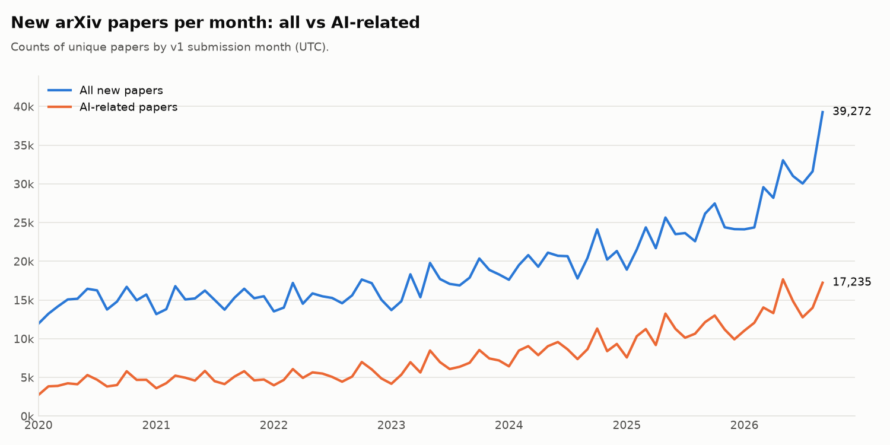

---

## Run measurements

Final run `local-1794448093838` (all 11 files, Windows 11, local mode with 24 cores). Wall-clock times include the actions inside each step ([`reports/performance_metrics.json`](reports/performance_metrics.json), [`reports/run_log.txt`](reports/run_log.txt)). Scan and shuffle numbers come from the Spark REST API of the same application ([`reports/spark_rest/`](reports/spark_rest)).

| Step | Time | What Spark did |
|---|---:|---|
| A1 load + `count()` | 3.1 s | row count of all 11 files (no column values needed): 3,224,635 rows |
| A2 quality checks | 10.5 s | 4 scans of the raw files: QA aggregation, monthly coverage, and two for the duplicate report |
| B1 clean + write | 14.6 s | scan of 11 files → 1,554,267 rows kept → shuffle by year (170.9 MiB) → 7 Parquet files, 94.4 MiB |
| B2 read back | 1.2 s | |
| B3 explode + join + write | 3.2 s | 2,872,031 exploded rows, broadcast join with 155 taxonomy rows, 1,826,011 unique (id, group) pairs |
| B4 groupBy summaries | 3.9 s | |
| C1 SQL 1 | 0.6 s | 81 monthly rows |
| C2 SQL 2 | 0.5 s | 8 subject groups |
| D1 read back + checks | 0.9 s | 29/29 checks passed ([`reports/validation_checks.json`](reports/validation_checks.json)) |
| P1–P4 extras | 71.4 s | pruning check, lazy demo, cache experiment (52.9 s), spot-check sample |
| **Total** | **158.0 s** | |

Raw input size on disk is 2.70 GB. Spark's scan metric "size of files read" (2.5 GiB) is the size of the files opened, not the bytes actually decoded. Spark only read 6 of the 14 columns. The task-level "Input Size" shown on the stage page (6.4 MiB) is clearly too small for that work, so it is not used as a measure of bytes read here.

---

## Performance analysis

Spark kept the work narrow from the start. The physical plan of the main cleaning query ([`reports/plans/B1_clean_papers.txt`](reports/plans/B1_clean_papers.txt), screenshot `03`) shows a single `Scan parquet` whose `ReadSchema` holds only `id, title, categories, abstract, versions, update_date`, 6 of the 14 columns, so authors, DOIs and comments are never decoded (column pruning). The two conditions on top-level columns appear as `PushedFilters: [IsNotNull(update_date), IsNotNull(id), GreaterThanOrEqual(update_date,2020-01-01T00:00)]`. The `update_date >= 2020-01-01` filter is a safe pre-filter, because a paper cannot be updated before its first submission (the QA step checks this: 0 in-window papers violate it). The conditions on the v1 date are computed from the nested `versions` array, so they cannot be pushed into the Parquet reader. Catalyst merged all four filters into one `Filter` node directly above the scan, inside the same whole-stage-codegen block. The two regex projections for the AI flags come after it, so the regexes only run on the 1,554,267 rows that pass. The taxonomy join became `BroadcastHashJoin LeftOuter BuildRight` with a 155-row `BroadcastExchange` (screenshot `04`), so the 2.87 million exploded rows were not shuffled for the join. The query has two exchanges: one for the `(id, subject_group)` de-duplication (37.9 MiB, with a partial `HashAggregate` before it, so duplicates inside a partition are removed early), and one for the year repartition before the write (30.1 MiB). AQE then coalesced the 48 shuffle partitions (`AQEShuffleRead coalesced` in the final plans). Partition pruning works on the output side. Reading the root of `outputs/papers_clean` with `submitted_year = 2025` gives `PartitionFilters: [isnotnull(submitted_year), (submitted_year = 2025)]`, and the scan read 1 of 7 partitions (1 file, 17.4 MiB, 284,162 rows) instead of 7 files and 94.4 MiB (screenshots `07`/`07b`).

The evidence also showed where the time goes and where the planned optimizations fell short. First, `PushedFilters` did not mean data was skipped. The B1 scan still produced all 3,224,635 rows, so no Parquet row group was dropped by the `update_date` condition, even though the files are sorted by that column. I could not pin down why (the column is stored as `INT64 TIMESTAMP(MILLIS, isAdjustedToUTC=false)` by pyarrow, and reading it as a plain timestamp did not change the result). The filter therefore only saves CPU by rejecting old rows before the v1 parsing. Second, the scan stage of B1 is unbalanced (screenshot `11`). With the default 128 MB splits it has 25 tasks for 24 cores, but because of the `update_date` ordering, only 12 tasks contain 2020–2026 papers. Those 12 take 8–13 s each to run the regexes and write the shuffle output, while the other 13 finish in about a second or less, so about half the cores are idle for most of the stage. Third, in the first full run (`local-1794447333346`, kept in [`reports/baseline_run/`](reports/baseline_run)) the slowest query was the duplicate-id report. It grouped whole rows, abstracts included, by `id`, shuffled 2.3 GiB and took 39.1 s, almost the whole 46.4 s of step A2. The `repartition("submitted_year")` before each write is a deliberate extra shuffle (170.9 MiB in B1). It gives one file per year folder instead of up to 25 × 7 small files.

What I changed and what came of it. The duplicate report now shuffles only the `id` column to find repeated ids and then fetches those 174 rows with a broadcast `LEFT SEMI` join. The query dropped from 39.1 s and 2.3 GiB of shuffle to 3.0 s and 27.3 MiB, step A2 from 46.4 s to 10.5 s, and the output file is byte-identical. `paper_subjects` is now also written partitioned by year. SQL 2 previously read all 24 files (13.0 MiB, 960,000 rows, 896 ms); now it reads 2 of 7 partitions (4.3 MiB, 636,653 rows, 374 ms) with identical results. For the unbalanced scan I tried smaller input splits in one application, with the same query and identical results ([`reports/split_size_benchmark.json`](reports/split_size_benchmark.json)). Medians of three runs were 9.06 s at 128 MB (25 tasks), 10.41 s at 64 MB (42 tasks) and 9.02 s at 32 MB (83 tasks). More tasks did not help, so the default stayed. Shuffle partitions are set to 48 (twice the 24 cores) instead of 200, since every shuffle here is small and AQE merges partitions anyway. The whole run takes 158 s on one machine in local mode. This is not a cluster experiment, and 2.7 GB would also fit on one machine without Spark. The workload still suits partitioned processing: the work is per row (date parsing and regex matching over 1.5 million abstracts) and splits cleanly by Parquet row groups across 24 parallel tasks. The cross-row work is reduced to small shuffles and one broadcast.

---

## Actions vs transformations

Code from `pipeline.py` (run in step P2 on the cleaned Parquet output):

```python
def lazy_demo_transformations(papers):
    return (papers
            .filter(F.col("submitted_year") == 2025)            # transformation
            .filter(F.col("ai_related"))                        # transformation
            .withColumn("title_words",                          # transformation
                        F.size(F.split(F.trim("title"), r"\s+"))))

def lazy_demo_action(demo):
    return (demo.groupBy("mentions_genai_llm")
            .agg(F.count("*").alias("papers"),
                 F.round(F.avg("title_words"), 2).alias("avg_title_words"))
            .orderBy("mentions_genai_llm")
            .collect())                                          # action
```

Recorded result ([`reports/lazy_demo.md`](reports/lazy_demo.md)): Spark jobs in the demo's job group were **0** before, **0** after the two filters and `withColumn` (16.5 ms, only a plan was built), and **4** after `collect()` (0.38 s). With AQE, each query stage of the aggregation runs as its own job. The action returned 89,484 AI-related 2025 papers without a GenAI/LLM mention (10.2 title words on average) and 40,474 with one (10.45 words).

Transformations such as `filter`, `withColumn`, `select` and `groupBy` only describe a new DataFrame. Spark records them in a logical plan and does nothing else. `demo.explain()` prints that plan without starting a job. An action such as `collect()`, `count()`, `show()` or `write` asks for a result. Only then does Catalyst optimize the whole chain (the two filters become one `Filter`, the year filter becomes a partition filter, unused columns are dropped) and run it as jobs. The action uses `title_words` in an aggregate on purpose. A plain `count()` could let the optimizer drop the unused column, so it would not show that the new column was computed. "Nothing runs before the action" refers to jobs. `spark.read.parquet` already lists files and reads the schema from Parquet footers. The timing difference is only there to show *when* work happens, not to measure a speed-up.

---

## Caching (optional bonus)

Step P3 runs the same action three times on the cleaned-papers DataFrame built from the raw files (scan + 4 filters + regex flags), then calls `.cache()`, fills the cache with `count()`, and runs the action three more times. The action groups by month and sums `ai_related` and `mentions_genai_llm`, so it uses the regex-derived columns.

| | Run 1 | Run 2 | Run 3 | Median |
|---|---:|---:|---:|---:|
| without cache | 10.81 s | 10.77 s | 11.27 s | **10.81 s** |
| filling the cache (`count()`) | 13.69 s | | | |
| with cache | 0.41 s | 0.28 s | 0.29 s | **0.29 s** |

The Storage tab showed 25 of 25 partitions cached, 100%, 228.2 MiB in memory (screenshots `09` and `10`). Cached and uncached results were identical. The DataFrame was unpersisted afterwards. Filling the cache cost about one extra scan, so caching pays off from the second repeated action on. All raw files were already in the OS file cache from earlier steps, so the uncached runs did not wait on the disk either.

---

## Screenshots

All UI screenshots were taken from the live Spark UI of the final run `local-1794448093838`, just before `spark.stop()` (the storage pages during the cache experiment). The full list with source URLs is in [`screenshots/index.json`](screenshots/index.json). The same run can be replayed with `python history_server.py`, since its event log is in `spark-events/`.

**Successful pipeline execution** – the data version from [`metadata/data_manifest.json`](metadata/data_manifest.json) (revision, 2,700,966,734 bytes, 3,224,635 rows) above the console log of the full run ([`reports/run_log.txt`](reports/run_log.txt)): every step, 29/29 checks, read-back of all outputs. This image shows the text of those two files and is not a Spark UI page.


**Jobs and SQL tabs** – every job succeeded; every query with its duration.


**Query details: B1 clean + write.** Scan metrics (11 files, 3,224,635 output rows) and the hover box with `PushedFilters` / `ReadSchema`; the `Exchange` for the write; physical plan text.


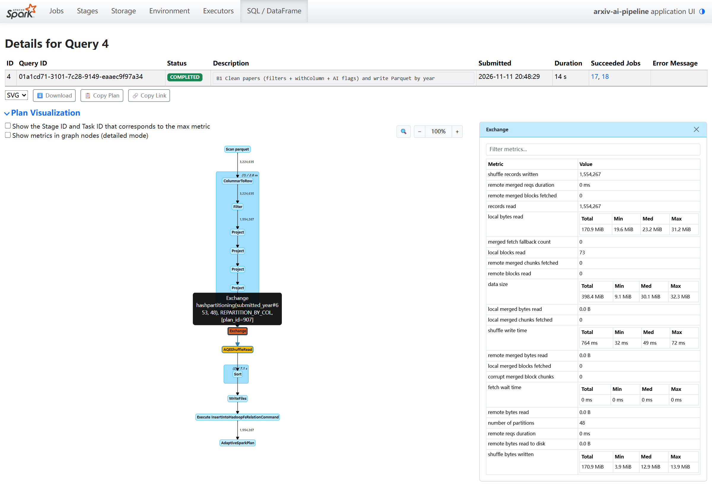


**Query details: B3 broadcast join.** `BroadcastHashJoin` output rows, the de-duplication `Exchange`, physical plan with `BroadcastExchange`.


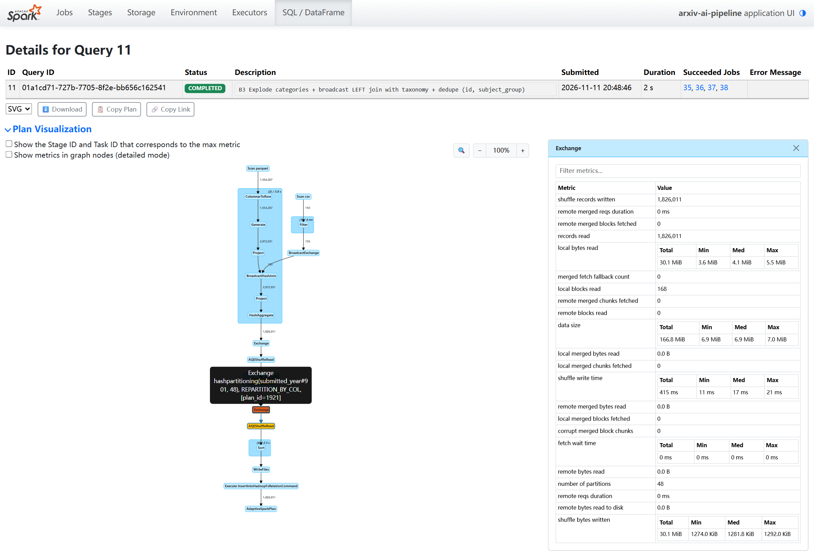
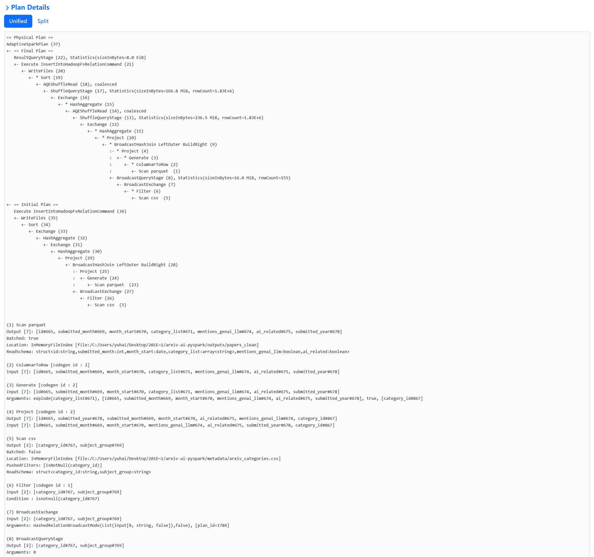

**The two SQL queries** (executed and written to Parquet). SQL 2 reads 2 of 7 year partitions.

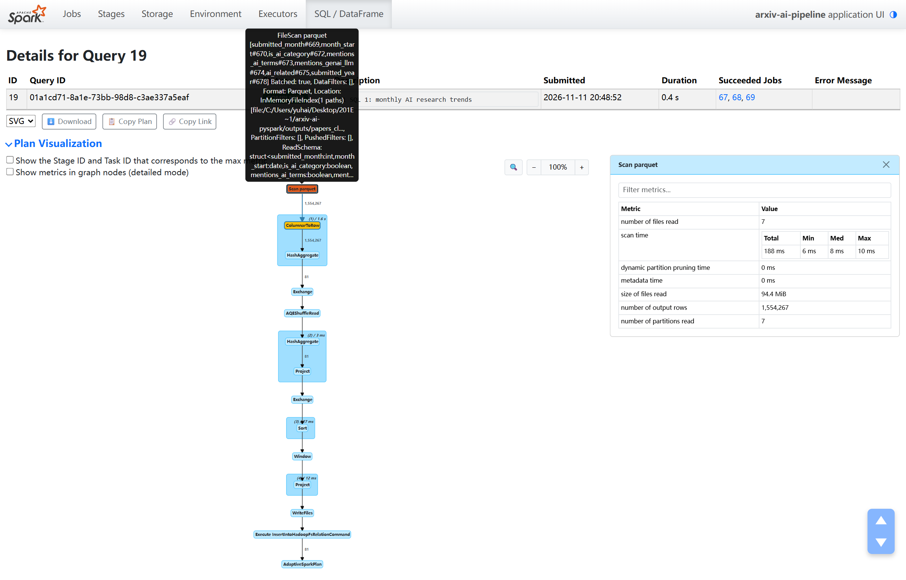
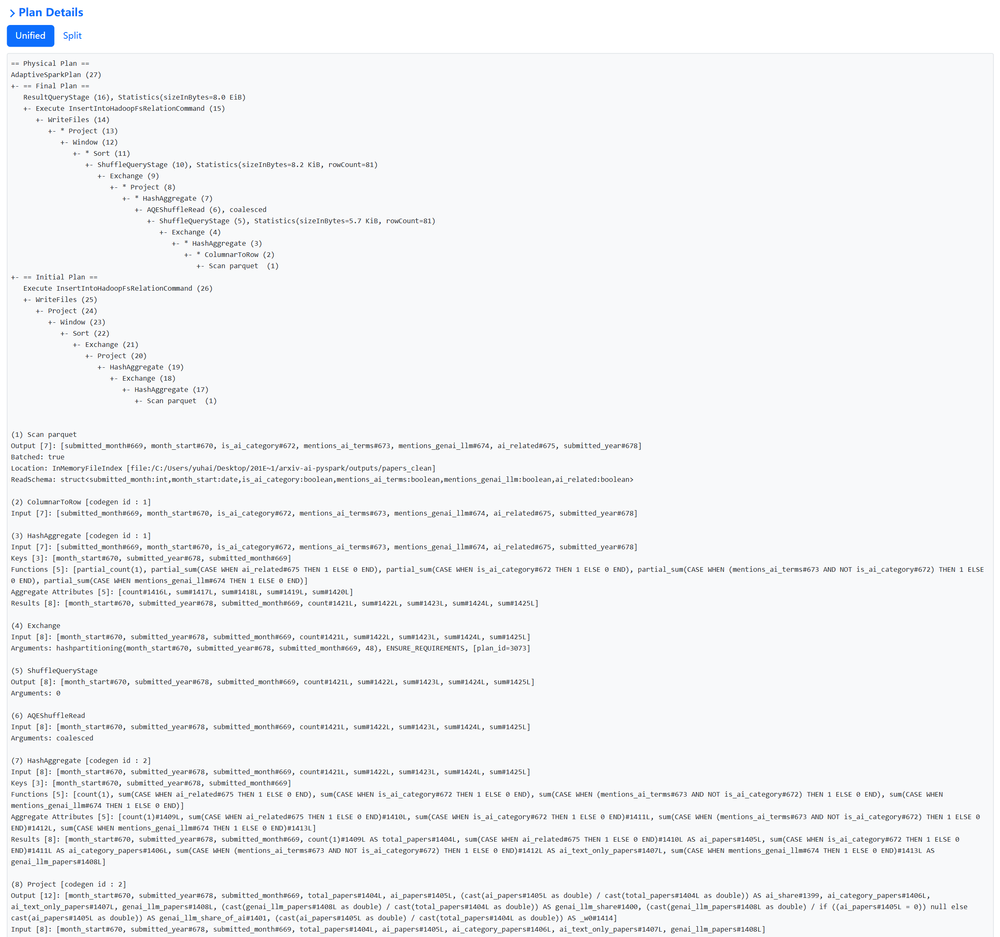

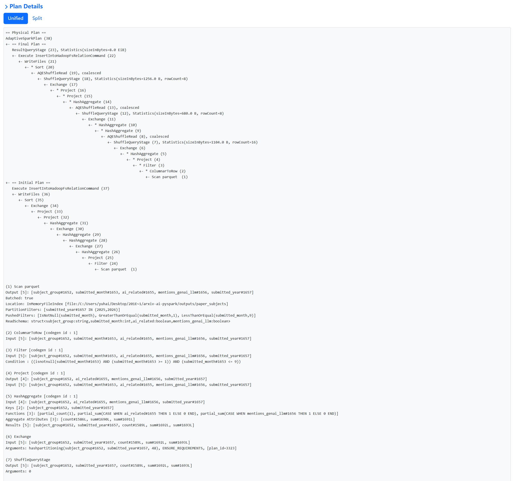

**Partition pruning** – `submitted_year = 2025` on the dataset root (1 partition read) vs no year filter (7 partitions).


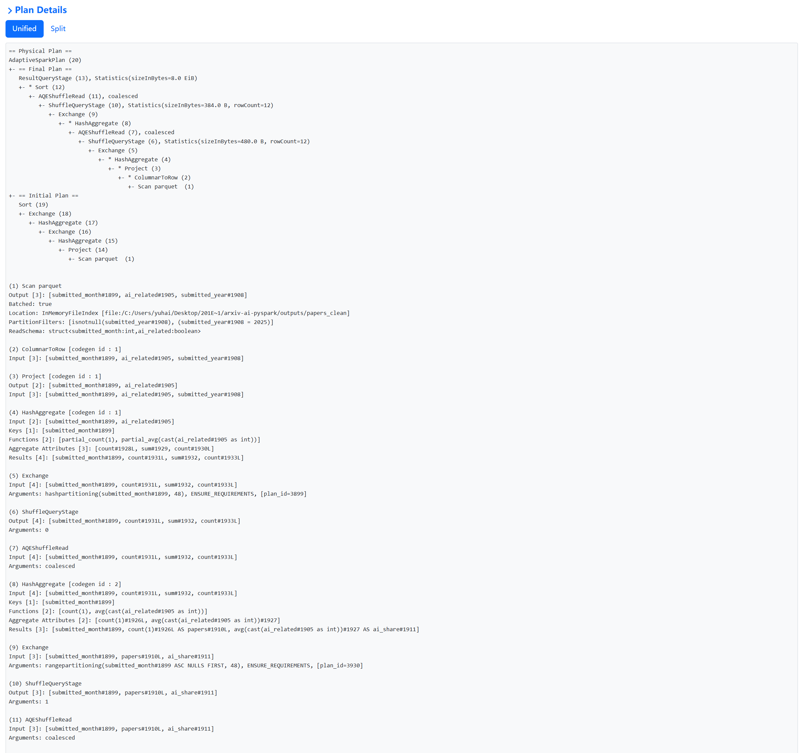


**Lazy evaluation demo** – the only query of the demo, started by `collect()`.


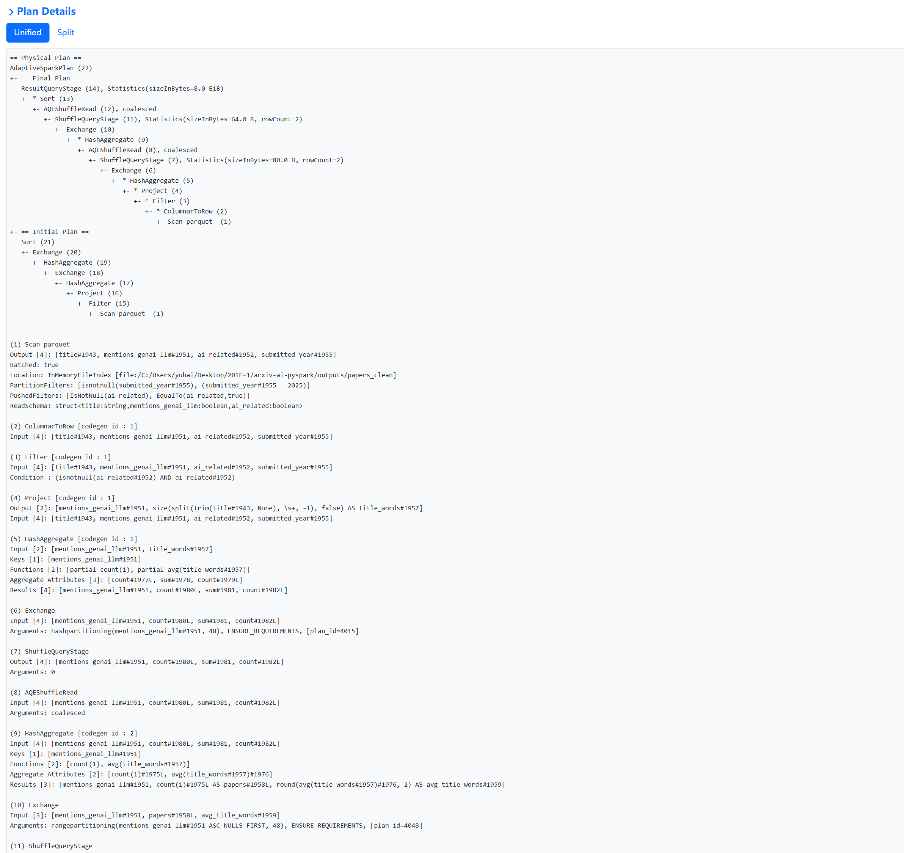

**Cache experiment** – Storage tab while the DataFrame was cached.


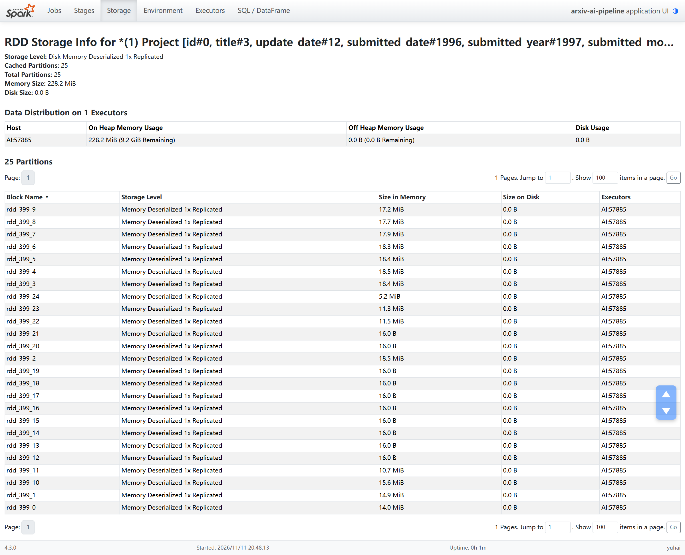

**Stage view of B1** – 25 tasks, 12 long and 13 short; plus the stage list and the single local executor.


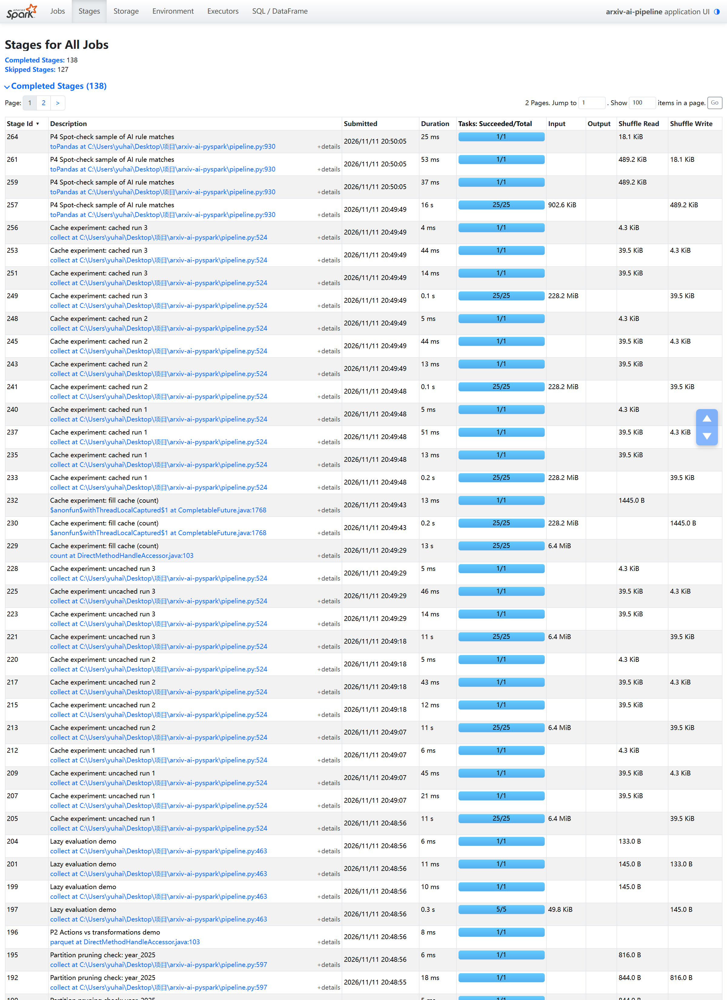
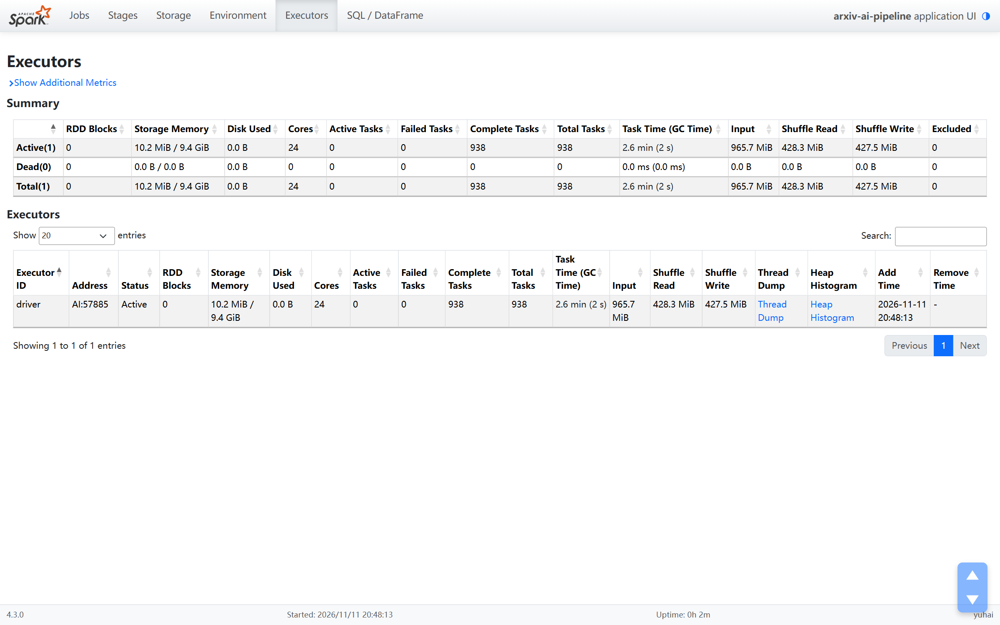

---

## Limitations

* **Descriptive only.** No causal claims, no significance tests. Year-to-year differences in small groups (Quantitative Finance, Economics, Quantitative Biology) can be noise.
* **arXiv is not all of science.** Fields such as medicine, chemistry and the social sciences use arXiv little, and willingness to post preprints changes over time.
* **Rule-based labels.** Category codes miss AI work filed elsewhere. Keywords catch papers that only mention ML in passing and miss papers that use other words (see the spot check). The bare words "agent" and "transformer" are excluded, which misses some recent AI-agent papers. No accuracy is claimed.
* **Snapshot metadata reflects later edits.** Titles, abstracts and categories are those of the latest version in the October 2026 snapshot. Grouping by v1 date does not recover what a paper looked like when first submitted, and cross-listing habits changed over time (finding 4).
* **Recent months.** September 2026 is the largest month in the data (39,272 papers). The data cannot show whether that is real growth or a change in submission patterns, and late-moderated papers may still be missing.
* **Single machine.** All timings come from one Windows PC in Spark local mode with warm OS file caches. They show how the plan behaves, not cluster performance.

---

## Repository layout

```
README.md                 this report
requirements.txt          tested package versions
download_data.py          pinned download + metadata/data_manifest.json
build_categories.py       arXiv taxonomy page -> metadata/arxiv_categories.csv
spark_session.py          SparkSession setup (+ Windows path / file-system workarounds)
pipeline.py               the pipeline (stages A-D, P1-P4)
sql/                      SQL 1 monthly_trends.sql, SQL 2 field_comparison.sql
make_charts.py            charts from the small CSV summaries
capture_screenshots.py    Spark UI screenshots (headless Chrome)
benchmark_split_size.py   input split size comparison
history_server.py         Spark History Server on spark-events/
tests/test_pipeline.py    unit tests on hand-made test rows
tools/windows/            Java source of the Windows local file-system helper
metadata/                 manifest, taxonomy CSV + source, AI rules, data card copy
reports/                  CSV results, plans, REST metrics, logs, figures, baseline run
screenshots/              Spark UI screenshots of the final run
.github/workflows/ci.yml  CI: unit tests on Ubuntu
```

---

## Rubric coverage

| Criterion | Status | Where in the code | Evidence |
|---|---|---|---|
| Dataset selection and loading | Done, full data | `download_data.py`; `pipeline.py` L726 (`spark.read.parquet` on all 11 files), L212 (column pruning) | `metadata/data_manifest.json` (2,700,966,734 bytes, 3,224,635 rows), screenshot `00` |
| Transformation: 2+ filters | Done | `clean_papers` L213, L215, L217, L219–220 (4 filters) | `reports/plans/B1_clean_papers.txt` |
| Transformation: join / complex aggregation | Done | `join_subjects` L264 (broadcast LEFT join with the taxonomy) | screenshot `04`, `reports/plans/B3_join_subjects.txt` |
| Transformation: groupBy + aggregation | Done | `annual_summary` L286, `multi_group_summary` L301, `duplicate_id_report` L421 | `reports/annual_full_years.csv`, `reports/multi_group_by_year.csv` |
| Transformation: withColumn | Done | `with_submission_date` L147, `add_time_columns` L166, `add_ai_flags` L175 | `reports/plans/B1_clean_papers.txt` |
| SQL queries (2+) | Done | `sql/monthly_trends.sql`, `sql/field_comparison.sql`, run at L861 and L865 | `reports/monthly_ai_trends.csv`, `reports/field_comparison_2025_2026.csv`, screenshots `05`, `06` |
| Optimization strategies | Done, measured | column pruning L212, early filters L213–220, broadcast join L264, year partitioning L768–769 and L808–810, semi-join duplicate report L421–429, shuffle partitions | Performance analysis; screenshots `03`, `04`, `06`, `07`; `reports/baseline_run/` |
| Output writing | Done, read back | Parquet writes at L769, L810, and in C1/C2 and B4; CSV summaries | `outputs/` (local, ignored by Git), `reports/validation_checks.json` |
| `.explain()` and Spark UI screenshots | Done | `save_plan` L124 (`explain("formatted")`) | `reports/plans/`, `screenshots/` |
| Performance analysis (2–3 paragraphs) | Done | – | [Performance analysis](#performance-analysis) |
| Actions vs transformations | Done | `lazy_demo_transformations` L445, `run_lazy_demo` | `reports/lazy_demo.md`, screenshot `08` |
| MLlib (0 points) | Not done (optional) | – | – |
| Caching (bonus) | Done | `run_cache_experiment` L527 | `reports/performance_metrics.json`, screenshots `09`, `10` |
