# AI Research Growth and Cross-Disciplinary Diffusion: A PySpark Analysis of arXiv, 2020–2026

[](https://github.com/USERZEROA/arxiv-ai-pyspark/actions/workflows/ci.yml)

A PySpark batch pipeline over **2.70 GB of arXiv metadata (3,224,635 records)**. It measures how many new arXiv papers are AI-related, how that share changed between January 2020 and September 2026, and how it differs across arXiv's subject groups.

* **RQ1** – How did the number and share of AI-related papers (and of papers mentioning generative AI / LLMs) change month by month?
* **RQ2** – How did the AI share of each arXiv subject group change from January–September 2025 to January–September 2026?

The analysis is descriptive. Category labels and keyword matches do not show that AI caused anything or that authors used AI tools.

Main script: [`pipeline.py`](pipeline.py) · SQL: [`sql/`](sql) · All figures and numbers below come from one full run, `local-1794448093838` (Windows 11, Spark 4.3.0 in single-machine local mode, 24 cores).

## Rubric overview

| Criterion | Section | Main evidence |
|---|---|---|
| Dataset selection and loading | [1](#1-dataset-and-loading) | 11 Parquet files, 2,700,966,734 bytes, loaded with `spark.read.parquet` |
| Transformation | [2](#2-transformations) | 4 filters, broadcast join, `groupBy().agg()`, `withColumn` |
| SQL queries | [3](#3-sql-queries) | 2 queries, both written to Parquet and used in the findings |
| Optimization strategies | [4](#4-optimization-strategies) | early filters, column pruning, partitioning by year, broadcast join, fewer shuffles |
| Output writing | [5](#5-output-writing) | Parquet (partitioned by year) + CSV summaries, read back and checked |
| Execution plan and Spark UI screenshots | [6](#6-execution-plans-and-spark-ui-screenshots) | `.explain("formatted")` files + live Spark UI screenshots |
| Performance analysis | [7](#7-performance-analysis) | 3 paragraphs based on the measured plans and metrics |
| Actions vs transformations | [8](#8-actions-vs-transformations) | job counts before/after the action |
| Caching (bonus) | [9](#9-caching-bonus) | 10.81 s → 0.29 s median for a repeated action |
| MLlib (0 points, optional) | – | not done |

---

## 1. Dataset and loading

| | |
|---|---|
| Source | arXiv → Cornell University's [Kaggle arXiv dataset](https://www.kaggle.com/datasets/Cornell-University/arxiv) → Parquet mirror [librarian-bots/arxiv-metadata-snapshot](https://huggingface.co/datasets/librarian-bots/arxiv-metadata-snapshot) (not an official Cornell release) |
| Pinned revision | [`c428226b689a0e17db2cd55265133b9eca15d97f`](https://huggingface.co/datasets/librarian-bots/arxiv-metadata-snapshot/commit/c428226b689a0e17db2cd55265133b9eca15d97f) |
| Size | **11 Parquet files, 2,700,966,734 bytes (2.70 GB)** on disk, each file equal to the size listed by the Hub ([`metadata/data_manifest.json`](metadata/data_manifest.json)) |
| Rows | **3,224,635**, counted by Spark, equal to the dataset card |
| Columns used | `id, title, abstract, categories, versions, update_date` (6 of 14) |
| Coverage | first-version (v1) dates 1986-04-25 to 2026-10-22 |
| License | metadata CC0-1.0 per the mirror's [data card](metadata/dataset_card_README.md); no paper full texts are downloaded |
| Second dataset | official [arXiv category taxonomy](https://arxiv.org/category_taxonomy) → [`metadata/arxiv_categories.csv`](metadata/arxiv_categories.csv): 155 unique codes, 8 subject groups, 6 official aliases mapped to their canonical code |

Loading ([`pipeline.py#L726`](pipeline.py#L726), [`#L212`](pipeline.py#L212)): all 11 files are read with `spark.read.parquet`, and only the 6 needed columns are selected. Parquet carries its own schema, so no inference is needed. The workload suits partitioned processing: every record needs date parsing and regex matching over its abstract, which splits cleanly into 25 parallel input tasks, and only small aggregated results ever leave Spark.

Data quality (one aggregation, [`reports/data_quality.json`](reports/data_quality.json)): every record has exactly one `v1` entry and every v1 date parses. No title, abstract or category is empty. 81 ids are duplicated, but all of them were first submitted in 1998–2007, outside the study window ([`reports/duplicate_ids.csv`](reports/duplicate_ids.csv)).

## 2. Transformations

[`clean_papers()`](pipeline.py#L199) turns raw records into one row per paper of the study window:

```python
df = raw.select(*NEEDED_COLUMNS)                                   # column pruning
df = df.filter(F.col("id").isNotNull() & (F.trim("id") != ""))   # filter 1
if use_update_prefilter:
    df = df.filter(F.expr(f"update_date >= TIMESTAMP_NTZ'{start} 00:00:00'"))  # filter 2
df = with_submission_date(df)                                      # withColumn: v1 timestamp
df = df.filter(F.col("submitted_ts").isNotNull())                # filter 3
df = add_time_columns(df)                                          # withColumn: date, year, month
df = df.filter((F.col("submitted_date") >= F.lit(start).cast("date"))
               & (F.col("submitted_date") < F.lit(end).cast("date")))  # filter 4
df = add_ai_flags(df, rules)                                       # withColumn: AI flags
```

`start = "2020-01-01"`, `end = "2026-10-01"` (exclusive).

* **withColumn** ([`#L147`](pipeline.py#L147), [`#L166`](pipeline.py#L166), [`#L175`](pipeline.py#L175)): `submitted_ts` comes from the `versions` entry labelled `v1` (picked by label, not position; the weekday prefix is removed, then `try_to_timestamp` parses the rest in UTC). Also `submitted_date`, `submitted_year`, `submitted_month`, `month_start`, `category_list`, `is_ai_category`, `mentions_ai_terms`, `mentions_genai_llm`, `ai_related`.
* **Join** ([`#L259`](pipeline.py#L259)): categories are exploded and **broadcast LEFT-joined** with the taxonomy CSV. Unknown codes would become `Unknown` instead of being dropped (there are none in the window). The result is reduced to unique `(id, subject_group)` pairs, so a paper counts once per group.
* **groupBy + aggregation** (DataFrame API): [`annual_summary()`](pipeline.py#L280) gives yearly totals for full years and for Jan–Sep; [`multi_group_summary()`](pipeline.py#L301) counts papers per id and then per year.

**AI definition** ([`metadata/classification_rules.json`](metadata/classification_rules.json)): `ai_related = is_ai_category OR mentions_ai_terms`.
* AI categories: `cs.AI, cs.LG, cs.CL, cs.CV, cs.RO, cs.MA, cs.NE, stat.ML`.
* AI terms: whole-phrase matches in title + abstract, such as *machine learning, deep learning, neural network(s), reinforcement learning, language model(s)*.
* GenAI/LLM terms: *generative AI, large language model(s), ChatGPT, GPT-2…5*, or the upper-case `LLM`.
* Ambiguous words (*transformer, diffusion, agent, attention*, bare *AI*) are not matched. A manual look at 36 sampled records is in [`reports/spot_check_review.md`](reports/spot_check_review.md); no accuracy figure is claimed.

## 3. SQL queries

Both queries run with `spark.sql` on temporary views ([`#L861`](pipeline.py#L861), [`#L865`](pipeline.py#L865)), are written to Parquet, read back, and checked against DataFrame results. They are shown below without their comment lines; full files: [`sql/monthly_trends.sql`](sql/monthly_trends.sql), [`sql/field_comparison.sql`](sql/field_comparison.sql).

**SQL 1 – Monthly AI research trends (RQ1).** One row per month; the denominator keeps non-AI papers. Output: [`reports/monthly_ai_trends.csv`](reports/monthly_ai_trends.csv) (81 months).

```sql
WITH monthly AS (
    SELECT
        month_start,
        submitted_year,
        submitted_month,
        COUNT(*)                                                              AS total_papers,
        SUM(CASE WHEN ai_related THEN 1 ELSE 0 END)                           AS ai_papers,
        SUM(CASE WHEN is_ai_category THEN 1 ELSE 0 END)                       AS ai_category_papers,
        SUM(CASE WHEN mentions_ai_terms AND NOT is_ai_category THEN 1 ELSE 0 END) AS ai_text_only_papers,
        SUM(CASE WHEN mentions_genai_llm THEN 1 ELSE 0 END)                   AS genai_llm_papers
    FROM papers
    GROUP BY month_start, submitted_year, submitted_month
)
SELECT
    month_start,
    submitted_year,
    submitted_month,
    total_papers,
    ai_papers,
    ai_papers / total_papers                                   AS ai_share,
    ai_category_papers,
    ai_text_only_papers,
    genai_llm_papers,
    genai_llm_papers / total_papers                            AS genai_llm_share,
    genai_llm_papers / NULLIF(ai_papers, 0)                    AS genai_llm_share_of_ai,
    LAG(ai_papers / total_papers, 12) OVER (ORDER BY month_start)            AS ai_share_prev_year,
    100 * (ai_papers / total_papers
           - LAG(ai_papers / total_papers, 12) OVER (ORDER BY month_start))  AS ai_share_yoy_change_pp
FROM monthly
ORDER BY month_start
```

**SQL 2 – Cross-disciplinary AI comparison, 2025 vs 2026, same months (RQ2).** Runs on unique `(id, subject_group)` pairs with `:last_month = 9`, so January–September 2026 is only compared with January–September 2025. Share changes are in percentage points; count changes are in percent, NULL for a zero base. Output: [`reports/field_comparison_2025_2026.csv`](reports/field_comparison_2025_2026.csv) (8 groups).

```sql
WITH by_group_year AS (
    SELECT
        subject_group,
        submitted_year,
        COUNT(*)                                              AS total_papers,
        SUM(CASE WHEN ai_related THEN 1 ELSE 0 END)           AS ai_papers,
        SUM(CASE WHEN mentions_genai_llm THEN 1 ELSE 0 END)   AS genai_llm_papers
    FROM paper_subjects
    WHERE submitted_year IN (2025, 2026)
      AND submitted_month BETWEEN 1 AND :last_month
    GROUP BY subject_group, submitted_year
),
pivoted AS (
    SELECT
        subject_group,
        SUM(CASE WHEN submitted_year = 2025 THEN total_papers     ELSE 0 END) AS total_2025,
        SUM(CASE WHEN submitted_year = 2025 THEN ai_papers        ELSE 0 END) AS ai_2025,
        SUM(CASE WHEN submitted_year = 2025 THEN genai_llm_papers ELSE 0 END) AS genai_llm_2025,
        SUM(CASE WHEN submitted_year = 2026 THEN total_papers     ELSE 0 END) AS total_2026,
        SUM(CASE WHEN submitted_year = 2026 THEN ai_papers        ELSE 0 END) AS ai_2026,
        SUM(CASE WHEN submitted_year = 2026 THEN genai_llm_papers ELSE 0 END) AS genai_llm_2026
    FROM by_group_year
    GROUP BY subject_group
),
shares AS (
    SELECT
        *,
        ai_2025 / NULLIF(total_2025, 0)        AS ai_share_2025,
        ai_2026 / NULLIF(total_2026, 0)        AS ai_share_2026,
        genai_llm_2025 / NULLIF(total_2025, 0) AS genai_llm_share_2025,
        genai_llm_2026 / NULLIF(total_2026, 0) AS genai_llm_share_2026
    FROM pivoted
)
SELECT
    subject_group,
    :last_month                                              AS months_compared,
    total_2025,
    ai_2025,
    ai_share_2025,
    genai_llm_2025,
    genai_llm_share_2025,
    total_2026,
    ai_2026,
    ai_share_2026,
    genai_llm_2026,
    genai_llm_share_2026,
    100 * (ai_share_2026 - ai_share_2025)                    AS ai_share_change_pp,
    100 * (genai_llm_share_2026 - genai_llm_share_2025)      AS genai_llm_share_change_pp,
    100 * (ai_2026 - ai_2025) / NULLIF(ai_2025, 0)           AS ai_papers_pct_change,
    100 * (total_2026 - total_2025) / NULLIF(total_2025, 0)  AS total_papers_pct_change
FROM shares
ORDER BY total_2026 DESC
```

## 4. Optimization strategies

| Strategy | What was done | Measured effect (run `local-1794448093838`) |
|---|---|---|
| Column pruning | `select` of 6 of 14 columns before anything else | `ReadSchema` lists only those 6 columns (screenshot 03) |
| Filters early | all 4 filters before the regex columns and before explode/join | Catalyst merged them into one `Filter` right above the scan; regexes run on 1,554,267 instead of 3,224,635 rows |
| Filter pushdown | `id` and `update_date` conditions are on top-level columns | shown in `PushedFilters`; the v1-date filters come from a nested array and are not pushable |
| Partitioning (disk) | outputs written with `partitionBy("submitted_year")`, one file per year | reading the root with `submitted_year = 2025` reads 1 of 7 partitions (17.4 MiB vs 94.4 MiB); SQL 2 reads 2 of 7 |
| Broadcast join | the 155-row taxonomy is broadcast | `BroadcastHashJoin`; the 2.87 M exploded rows are not shuffled for the join |
| Fewer / smaller shuffles | duplicate check shuffles only `id`, then a broadcast semi join | 39.1 s and 2.3 GiB of shuffle → 3.0 s and 27.3 MiB (same output) |
| Shuffle partitions | 48 (2 × 24 cores) instead of 200; AQE enabled | AQE coalesced the shuffle reads (`AQEShuffleRead coalesced`) |

## 5. Output writing

| Output (Parquet, in `outputs/`, not committed because of size) | Content |
|---|---|
| `papers_clean/submitted_year=YYYY/` | 1,554,267 cleaned papers, 7 year folders |
| `paper_subjects/submitted_year=YYYY/` | 1,826,011 unique (paper, subject group) pairs |
| `sql1_monthly_trends/`, `sql2_field_comparison/` | the two SQL results |
| `annual_summary/`, `multi_group_by_year/` | the DataFrame `groupBy` results |

Every output is read back. 29 checks compare it with independent counts, for example: rows written equal distinct in-window ids from the QA step; SQL 1 monthly totals equal the `groupBy` yearly totals; SQL 2 group totals equal the unique pairs for Jan–Sep. All 29 passed ([`reports/validation_checks.json`](reports/validation_checks.json)). Small CSV copies of all results are in [`reports/`](reports).

## 6. Execution plans and Spark UI screenshots

`.explain("formatted")` is saved for every main query in [`reports/plans/`](reports/plans) ([`save_plan()`](pipeline.py#L124)). Key lines from the cleaning query ([`B1_clean_papers.txt`](reports/plans/B1_clean_papers.txt)) and the join ([`B3_join_subjects.txt`](reports/plans/B3_join_subjects.txt)):

```text
-- B1_clean_papers.txt (Scan node; nested type of `versions` shortened)
(1) Scan parquet
PushedFilters: [IsNotNull(update_date), IsNotNull(id), GreaterThanOrEqual(update_date,2020-01-01T00:00)]
ReadSchema: struct<id:string,title:string,categories:string,abstract:string,versions:array<struct<...>>,update_date:timestamp_ntz>

-- B3_join_subjects.txt
AdaptiveSparkPlan (9)
+- Project (8)
   +- BroadcastHashJoin LeftOuter BuildRight (7)
      :- Project (3)
      :  +- Generate (2)
      :     +- Scan parquet  (1)
      +- BroadcastExchange (6)
         +- Filter (5)
            +- Scan csv  (4)
```

All screenshots below are from the live Spark UI of the final run (all files are in [`screenshots/`](screenshots), listed in [`index.json`](screenshots/index.json)).

**Successful execution.** Data version from the manifest above the console log of the run: 11 files, 2,700,966,734 bytes, 3,224,635 rows, every step, 29/29 checks. This image shows the text of [`reports/run_log.txt`](reports/run_log.txt); it is not a UI page.

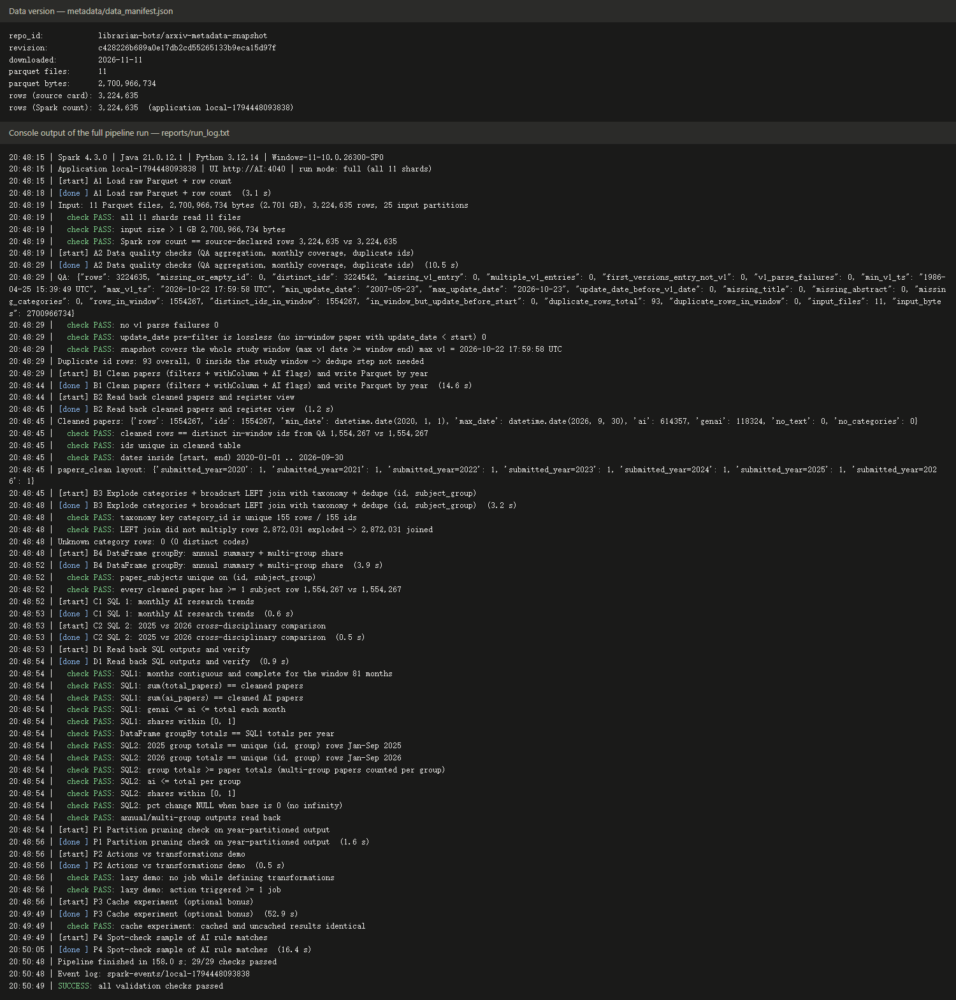

Jobs tab: 139 completed jobs, none failed. SQL tab: 38 queries, 0 failed (the 20 latest are listed).

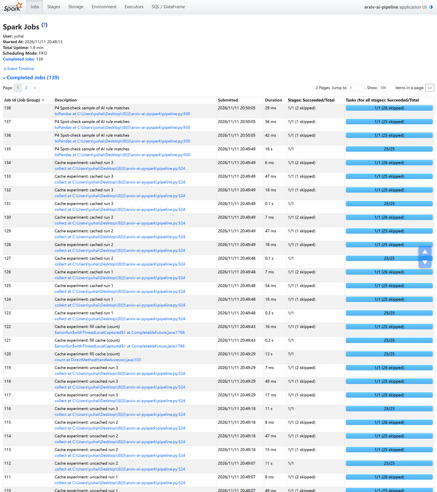
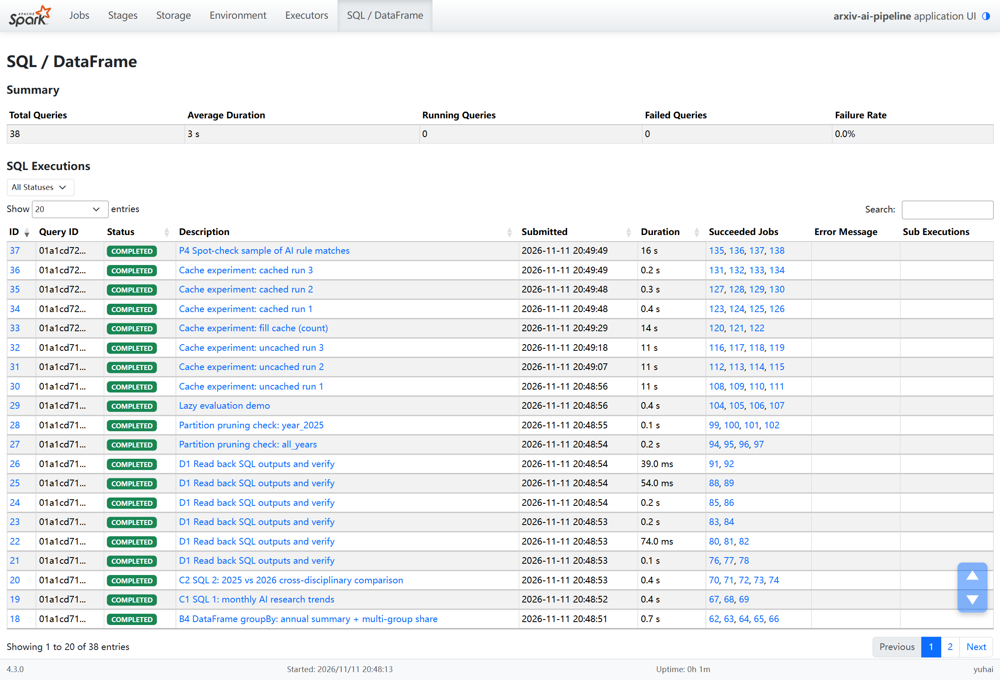

**Query details – B1 clean + write.** `Scan parquet`: 11 files, 3,224,635 output rows, and the `Filter` keeps 1,554,267. The hover box shows `PushedFilters` and `ReadSchema`. Below it is the final adaptive physical plan.

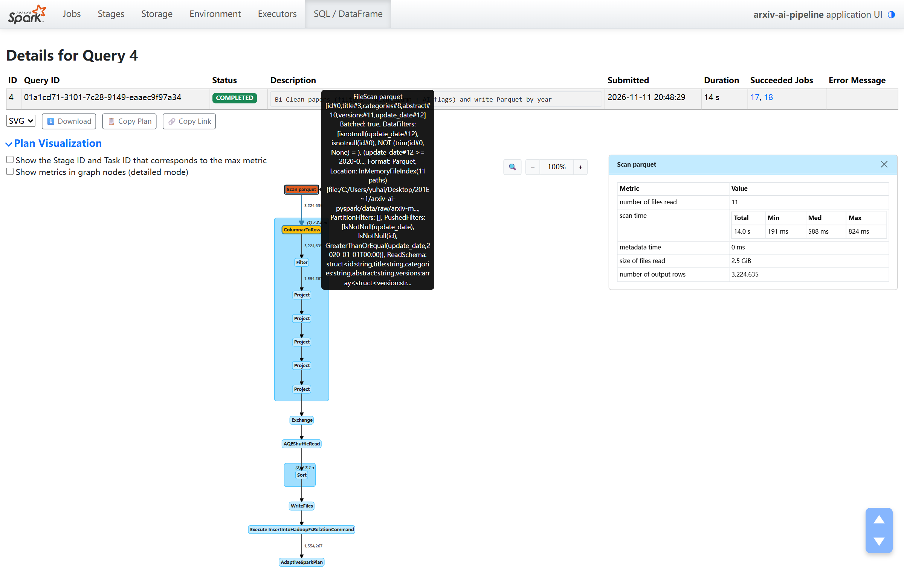
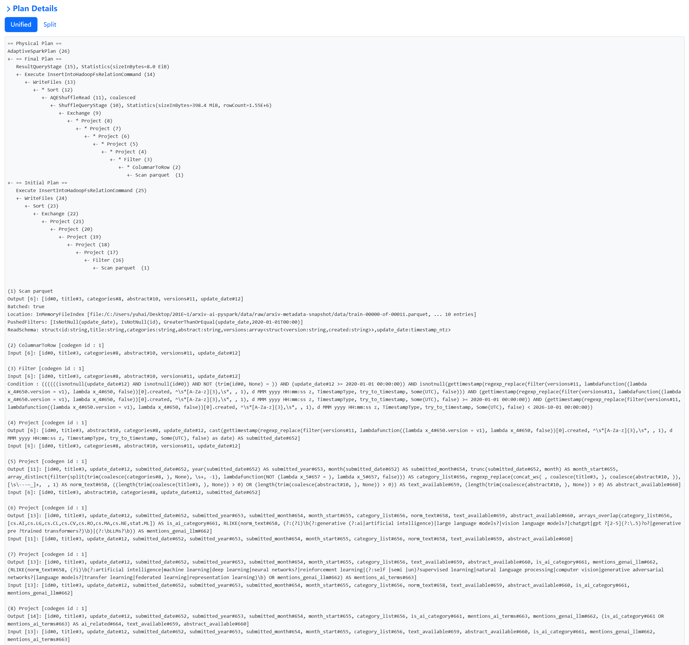

**Query details – B3 broadcast join.** `BroadcastHashJoin LeftOuter BuildRight` with 2,872,031 output rows; the taxonomy side is a 155-row `Scan csv` → `BroadcastExchange`.

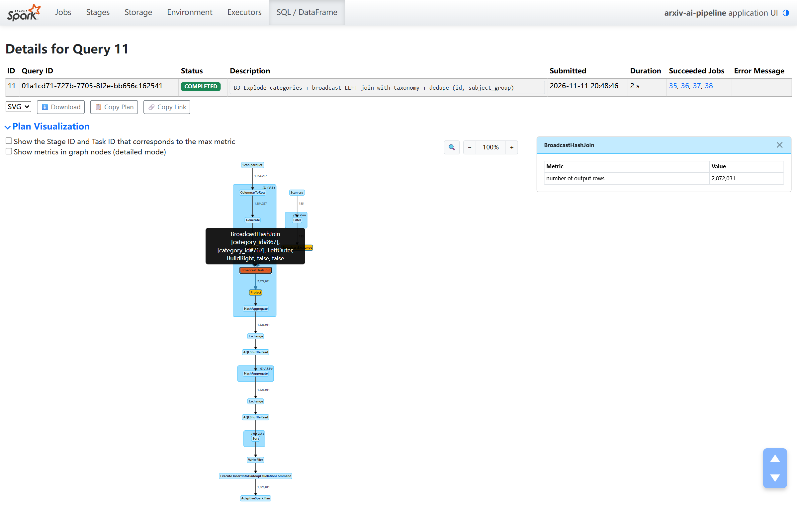

**Query details – SQL 2.** `PartitionFilters: [submitted_year IN (2025,2026)]`: 2 partitions, 2 files, 636,653 rows read. The month conditions are pushed to Parquet.

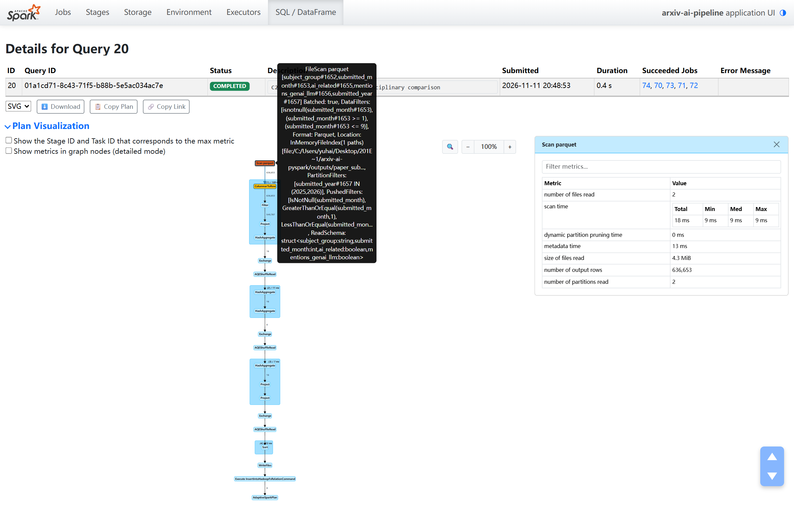

**Partition pruning.** Same query on the dataset root, with `submitted_year = 2025` (1 partition, 17.4 MiB) and without a year filter (7 partitions, 94.4 MiB).

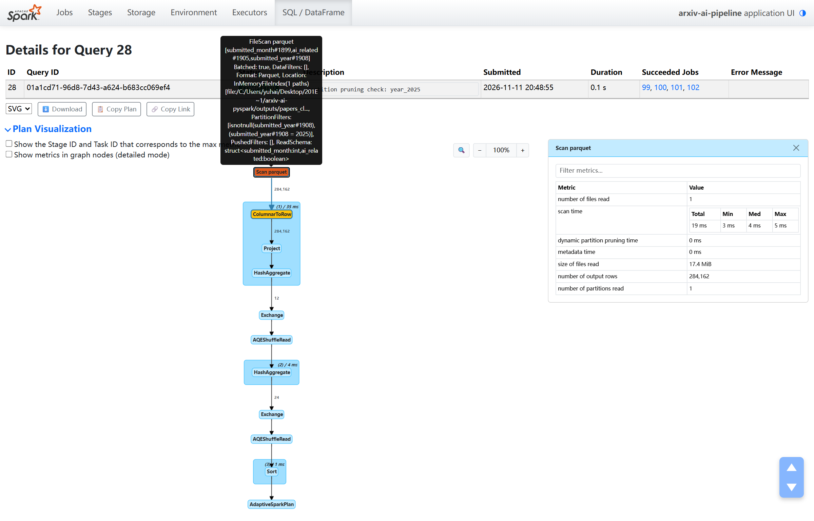
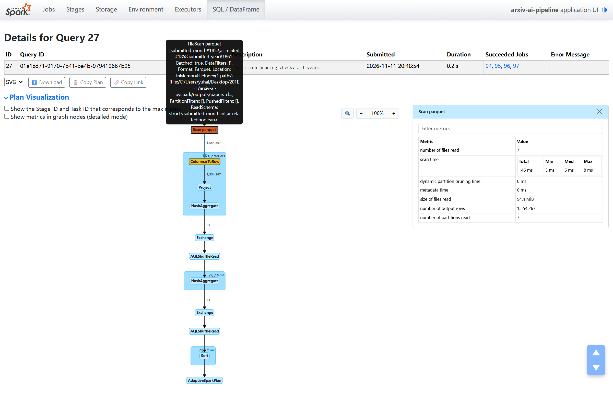

**Stage view of B1.** 25 scan tasks: 12 take 8–13 s, 13 take about 1 s or less (see section 7).

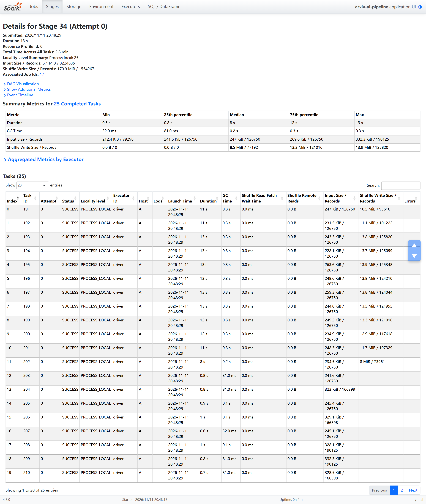

Other screenshots in the folder: SQL 1 details (`05_*`), plan texts of B3/SQL 1/SQL 2/pruning (`*_physical_plan.png`), the B1 and B3 `Exchange` metrics, the stages list (`12_*`) and the executors page with a single 24-core local driver (`13_*`).

## 7. Performance analysis

Spark kept the main cleaning query narrow. Its physical plan reads one `Scan parquet` whose `ReadSchema` has only the 6 needed columns, so authors, DOIs and comments are never decoded (column pruning). The conditions on top-level columns appear as `PushedFilters: [IsNotNull(update_date), IsNotNull(id), GreaterThanOrEqual(update_date, 2020-01-01)]`. The `update_date` condition is a safe pre-filter, because a paper cannot be updated before its first submission (the QA step found 0 violations). The v1-date filters depend on the nested `versions` array and cannot be pushed into the Parquet reader. Catalyst merged all four filters into one `Filter` directly above the scan in the same code-generated stage, and the two regex projections come after it, so the regexes only run on the 1,554,267 rows that pass. The taxonomy join became a `BroadcastHashJoin` with a 155-row `BroadcastExchange`, so the 2.87 million exploded rows were not shuffled for it. The remaining shuffles are the de-duplication of `(id, subject_group)` (37.9 MiB, with a partial aggregate before the exchange) and the year repartition before each write. AQE coalesced the 48 shuffle partitions. On the output side, partition pruning works as expected: `PartitionFilters: [isnotnull(submitted_year), (submitted_year = 2025)]` reads 1 of 7 folders (17.4 MiB instead of 94.4 MiB), and SQL 2 reads 2 of 7.

The measurements also showed the bottlenecks. A pushed filter did not mean skipped data: the B1 scan still returned all 3,224,635 rows, so the `update_date` condition dropped no Parquet row group, even though the files are sorted by that column. I could not find out why; reading the column as a normal timestamp gave the same result. The filter therefore only saves CPU by rejecting old rows before the date parsing. The scan stage itself is unbalanced (screenshot 11). With the default 128 MB splits there are 25 tasks for 24 cores, but only 12 tasks hold 2020–2026 papers. Those 12 run the regexes for 8–13 s each while the others finish in about a second, so roughly half the cores are idle for most of the stage. The biggest single cost in the first full run (`local-1794447333346`, kept in [`reports/baseline_run/`](reports/baseline_run)) was the duplicate-id report. It grouped whole rows, abstracts included, by `id`, shuffled 2.3 GiB and took 39.1 s, almost all of the 46.4 s quality step.

I changed the duplicate report to shuffle only the `id` column and fetch the 174 duplicated rows with a broadcast `LEFT SEMI` join. That query went from 39.1 s and 2.3 GiB of shuffle to 3.0 s and 27.3 MiB, and the whole quality step from 46.4 s to 10.5 s, with a byte-identical output file. Writing `paper_subjects` partitioned by year cut SQL 2 from 24 files, 960,000 rows and 896 ms to 2 partitions, 636,653 rows and 374 ms, with identical results. For the unbalanced scan I compared input split sizes in one application with the same query ([`reports/split_size_benchmark.json`](reports/split_size_benchmark.json)). Medians of three runs were 9.06 s at 128 MB, 10.41 s at 64 MB and 9.02 s at 32 MB. More tasks did not help, so the default was kept. The full pipeline takes 158 s. All timings come from one PC in local mode with warm OS file caches, so they describe plan behaviour, not cluster performance.

## 8. Actions vs transformations

```python
# transformations: only a plan is built
demo = (papers
        .filter(F.col("submitted_year") == 2025)
        .filter(F.col("ai_related"))
        .withColumn("title_words", F.size(F.split(F.trim("title"), r"\s+"))))

# action: collect() of an aggregate that uses the new column
rows = (demo.groupBy("mentions_genai_llm")
            .agg(F.count("*").alias("papers"), F.round(F.avg("title_words"), 2).alias("avg_title_words"))
            .collect())
```

| Moment | Spark jobs (demo job group) | Time |
|---|---:|---:|
| before | 0 | |
| after 2 × `filter` + `withColumn` | **0** | 16.5 ms |
| after `collect()` | **4** | 0.38 s |

Result: 89,484 AI-related 2025 papers without a GenAI/LLM mention (10.2 title words on average) and 40,474 with one (10.45). The single query started by `collect()` is shown in screenshot 08, where its `Project` node computes `title_words`. Full record: [`reports/lazy_demo.md`](reports/lazy_demo.md).

Transformations (`filter`, `withColumn`, `select`, `groupBy`) only describe a new DataFrame; Spark adds them to a logical plan, and `explain()` can print that plan without running a job. An action (`collect`, `count`, `show`, `write`) needs a result, so Spark optimizes the whole chain and runs it as jobs. In this plan the year filter became `PartitionFilters: [... (submitted_year = 2025)]` and the `ai_related` filter was pushed to the Parquet reader ([`lazy_demo_plan.txt`](reports/plans/lazy_demo_plan.txt)). The 4 jobs come from AQE running each stage of the aggregation as its own job. The action uses `title_words` on purpose, because a plain `count()` could let the optimizer skip the unused column. `spark.read.parquet` itself already lists files and reads the schema, so "nothing runs" refers to jobs. The time difference only shows *when* work happens; it is not a speed-up.

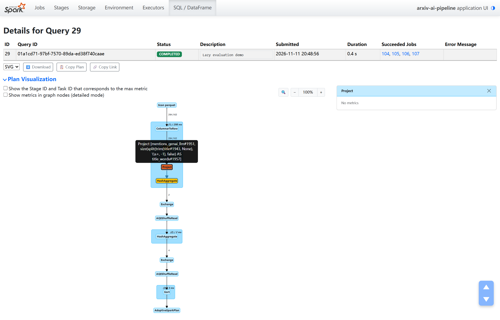

## 9. Caching (bonus)

The same action (monthly counts of `ai_related` and `mentions_genai_llm`) on the cleaned-papers DataFrame built from the raw files, three times without and three times with `.cache()`:

| | Run 1 | Run 2 | Run 3 | Median |
|---|---:|---:|---:|---:|
| without cache | 10.81 s | 10.77 s | 11.27 s | **10.81 s** |
| `count()` to fill the cache | 13.69 s | | | |
| with cache | 0.41 s | 0.28 s | 0.29 s | **0.29 s** |

Results were identical. The Storage tab showed 25/25 partitions, 100% cached, 228.2 MiB in memory, and the DataFrame was unpersisted afterwards. Filling the cache costs about one extra scan, so it pays off from the second repeated action.

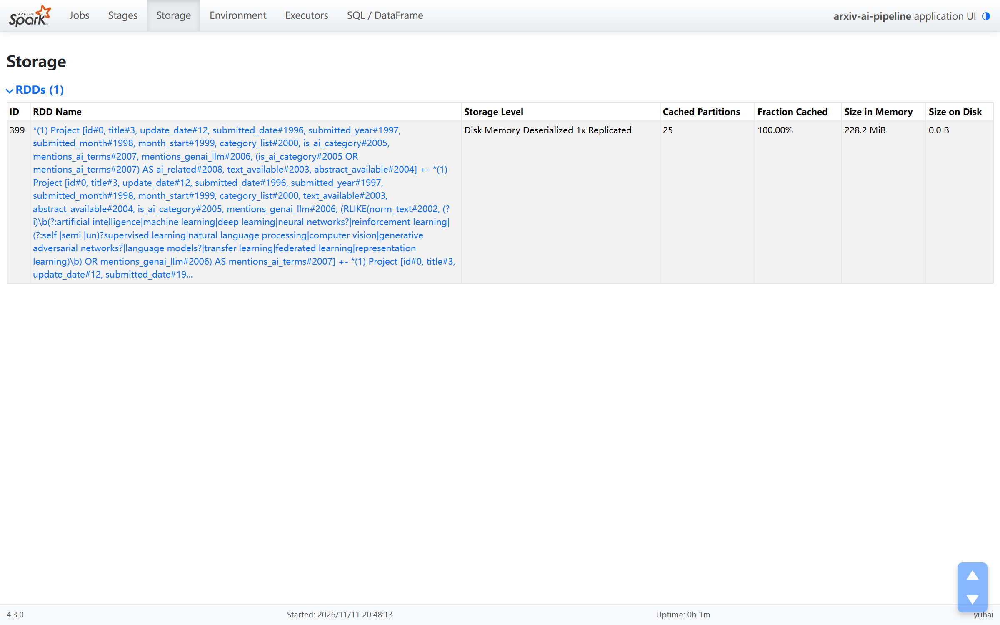

## 10. Key findings

1,554,267 papers first submitted (v1 date, UTC) between January 2020 and September 2026. The snapshot ends on 2026-10-22, so 2026 is compared only with January–September of earlier years.

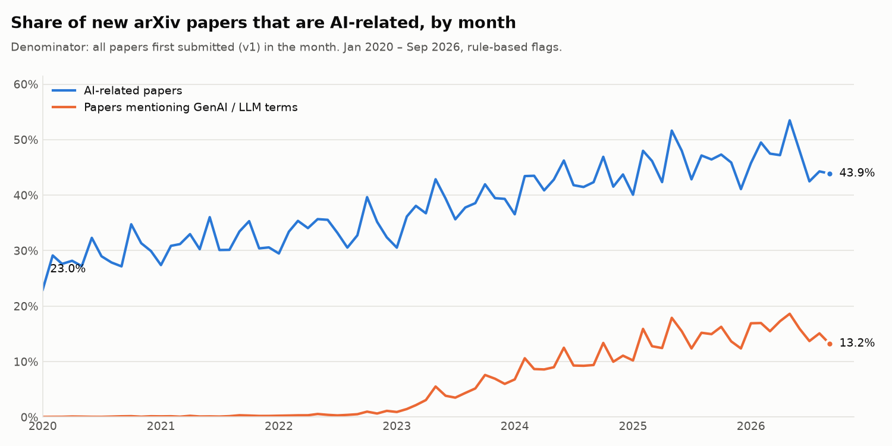

1. **The AI-related share rose every full year, from 29.2% (51,978 of 178,275) in 2020 to 45.7% (129,958 of 284,162) in 2025.** AI-related papers grew faster than all papers each year (e.g. +29.9% vs +16.5% in 2024). In January–September 2026 the share was 46.8%, only +0.8 percentage points above the same months of 2025, after gains of +4.2, +4.6 and +3.8 points in 2023–2025.
2. **Papers mentioning generative AI / LLMs went from 0.09% (166) in 2020 to 14.2% (40,474) in 2025**, and 15.8% in January–September 2026. The flag means an abstract talks about these models, not that authors used them.
3. **January–September 2026 vs 2025 by subject group** ([CSV](reports/field_comparison_2025_2026.csv)): the AI share stayed flat in Computer Science (84.2%, +0.2 pp), Physics (9.9%) and Mathematics (9.9%). It fell in Electrical Engineering and Systems Science (59.2% → 49.0%) and Statistics (−3.2 pp). The GenAI/LLM share rose in all 8 groups, e.g. Computer Science 27.5% → 29.6% and Economics 6.0% → 8.1%. No significance test was run; small groups can move by chance.
4. **The share of AI papers listed in ≥2 subject groups fell from 44.7% (2020) to 15.5% (Jan–Sep 2026).** This mainly reflects listing practice: 57.5% of `cs.LG` papers in early 2020 were also listed in `stat.ML`, against 11.0% in early 2026 ([CSV](reports/cs_lg_stat_ml_crosslist.csv)). Multi-group labels are therefore not used as evidence of "diffusion".

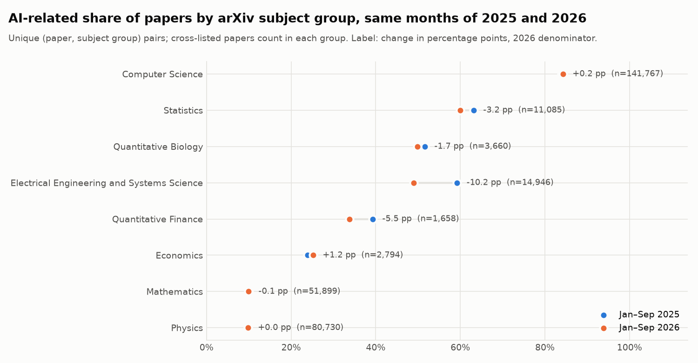

**Limitations.** Descriptive only. arXiv does not cover all of science. Rule-based labels miss some AI work and include papers that mention ML in passing. Snapshot metadata reflects later revisions, not the text at first submission. Results come from a single machine in local mode.

## How to run

```bash
pip install -r requirements.txt            # Python 3.12, Java 17+ (a JDK with javac on Windows)
python download_data.py                    # pinned 2.7 GB snapshot + metadata/data_manifest.json
python pipeline.py --capture-ui            # full run, outputs/ + reports/ + screenshots/
python capture_screenshots.py --log reports/run_log.txt --out screenshots/00_run_log_full_pipeline.png
python -m pytest -q tests                  # unit tests on small hand-made rows (also run in CI)
python history_server.py                   # replay saved event logs at http://localhost:18080
```

`python pipeline.py --dev` runs on one file for development only. On Windows, [`spark_session.py`](spark_session.py) handles a non-ASCII project path and replaces `winutils.exe` with a small locally compiled helper ([`tools/windows/`](tools/windows)); nothing changes on Linux/macOS. `data/`, `outputs/` and `spark-events/` are kept out of Git because of their size.
